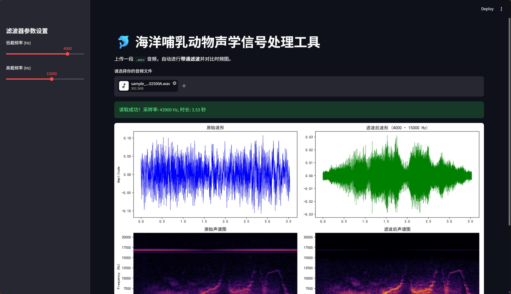

# Bioacoustics Data Processing (First Try)
开始日期：2026 11 25
这是我在大二上学期尝试处理海洋哺乳动物声信号的第一次尝试。

## 目前完成的工作
- 从 Watkins Marine Mammal Sound Database 下载了 Atlantic Spotted Dolphin (大西洋斑海豚) 的原始音频数据。
- 使用 Python 读取音频并绘制了时域波形图。
- 使用 `scipy.signal.spectrogram` 绘制了时频图（声谱图），并与官方给出的声谱图进行了对比验证。
- 观察到了海豚 click 信号的能量集中在约 4-10 kHz，以及约 17.5 kHz 处存在明显的设备/环境干扰线。

## 环境依赖
- Python 3.10
- numpy, matplotlib, scipy

## 处理结果
这是我用 Python 跑出的波形图和声谱图：

## 下一步计划
- 尝试加入带通滤波器（如 4-15 kHz），滤除高频干扰。
- 学习如何用阈值法自动检测 click 信号。

## 2026-11-28 更新：交互式网页应用
- 基于 Streamlit 开发了前端界面。核心算法（读数据、滤波、画图）已解耦并封装在 `test.py` 中，通过 `Web_App.py` 调用，实现了滑块实时调节与结果展示。
- 
